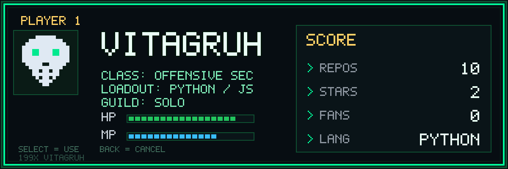
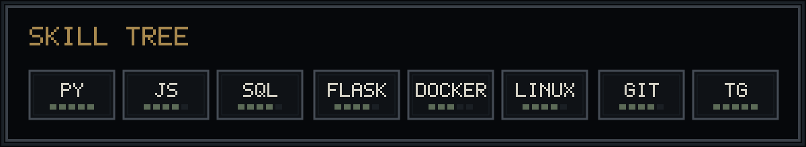

| PROJECT | ENGLISH | РУССКИЙ |
| --- | --- | --- |
| **[passrw-bot](https://github.com/vitagruh/passrw-bot)** | Telegram bot that hunts BZD train tickets: step-by-step search, inline calendar, up to 5 trains per user, Flask admin panel, SQLite. | Telegram-бот для охоты за билетами БЖД: пошаговый поиск, inline-календарь, до 5 поездов на пользователя, админка на Flask, SQLite. |
| **[kuma-correlation-stats](https://github.com/vitagruh/kuma-correlation-stats)** | Daily rule-trigger statistics for Kaspersky KUMA: REST API v3, SQLite history, anomaly hunt, HTML report with charts, CSV/JSON export and notifications. | Ежедневная статистика сработок правил Kaspersky KUMA: REST API v3, история в SQLite, поиск аномалий, HTML-отчёт с графиками, экспорт CSV/JSON и уведомления. |
| **[minsk-transport](https://github.com/vitagruh/minsk-transport)** | PWA departure board for Minsk transport at your favourite stops: auto-refresh, directory search, map; no API keys, no dependencies. | PWA-табло транспорта Минска на избранных остановках: автообновление, поиск по справочнику, карта; без API-ключей и зависимостей. |
| **[qoder-telegram-bot](https://github.com/vitagruh/qoder-telegram-bot)** | aiogram 3 bot that runs Qoder tasks on a Linux box: sessions, file uploads, button confirmations, usage stats. | Бот на aiogram 3, который запускает задачи Qoder на Linux: сессии, загрузка файлов, подтверждения кнопками, статистика расхода. |

**EN** — Keep the dull parts on autopilot: pull telemetry from the systems that matter, hunt anomalies in it, push the result to Telegram, and host every piece yourself. Small Python tools, no cloud lock-in.

**RU** — Держать рутину на автопилоте: тянуть телеметрию из важных систем, искать в ней аномалии, доставлять результат в Telegram и хостить каждую часть у себя. Маленькие инструменты на Python, без привязки к облаку.

  <picture>
    <source media="(prefers-color-scheme: dark)" srcset="https://raw.githubusercontent.com/vitagruh/vitagruh/output/github-snake-dark.svg" />
    
  </picture>

  

