  

## Обо мне

- Наступательная безопасность: пентест-инструменты, SIEM (Kaspersky KUMA), ICAP-интеграции
- Python: Telegram-боты, парсинг, отчёты и автоматизация
- Веб без зависимостей: PWA на чистом JavaScript
- Linux, Docker и SQLite как ежедневный стек

## Проекты

- **[passrw-bot](https://github.com/vitagruh/passrw-bot)** — Telegram-бот слежения за билетами БЖД: пошаговый поиск, inline-календарь, до 5 поездов на пользователя, Flask-админка и SQLite.
- **[kuma-correlation-stats](https://github.com/vitagruh/kuma-correlation-stats)** — ежедневная статистика сработок правил Kaspersky KUMA: REST API v3, история в SQLite, поиск аномалий, HTML-отчёт с графиками, CSV/JSON и уведомления.
- **[minsk-transport](https://github.com/vitagruh/minsk-transport)** — PWA-табло транспорта Минска на избранных остановках: автообновление, поиск по справочнику и карта; без API-ключей и зависимостей.
- **[qoder-telegram-bot](https://github.com/vitagruh/qoder-telegram-bot)** — бот на aiogram 3 для запуска задач Qoder на Linux: сессии, загрузка файлов, подтверждения кнопками и статистика расхода.

## Навыки

  

## Статистика

  

  
  

  
  

## Contribution-змейка

  <picture>
    <source media="(prefers-color-scheme: dark)" srcset="https://raw.githubusercontent.com/vitagruh/vitagruh/output/github-snake-dark.svg" />
    
  </picture>

  

